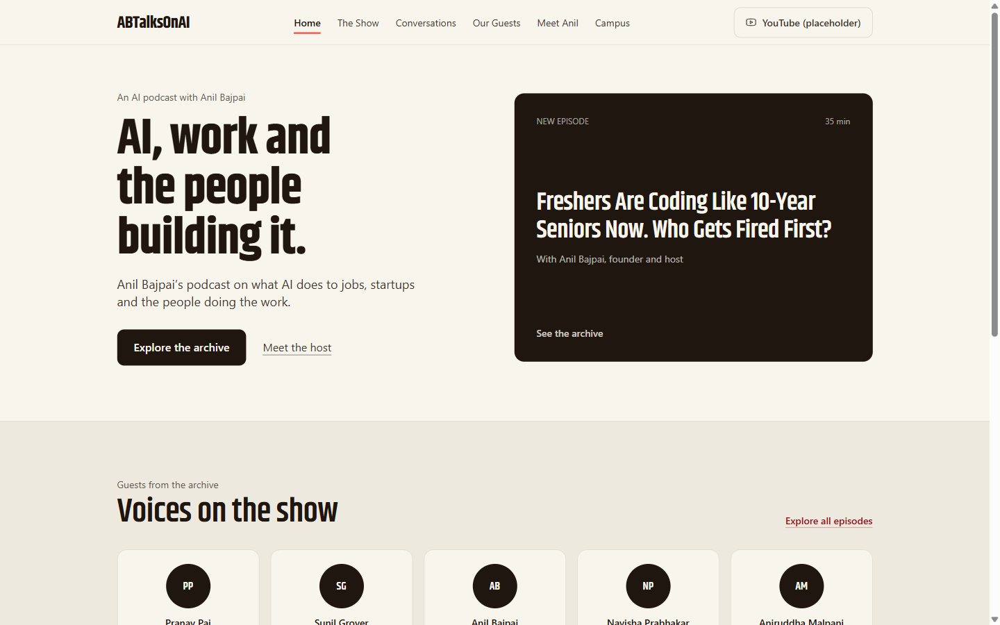
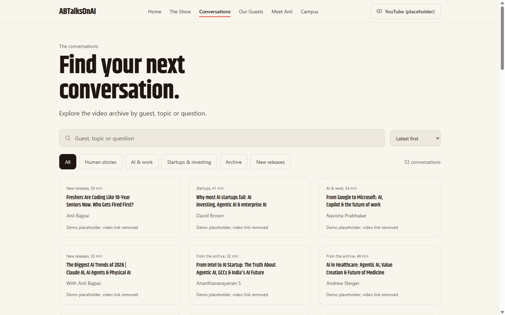

# ABTalksOnAI, a redesign concept 🎙️

> **Unofficial redesign of the ABTalksOnAI podcast, built for the ABTalks Vibe Code Hackathon 2026.**
> Not affiliated with or endorsed by ABTalksOnAI. All brand assets belong to their owners.

[](https://www.abtalks.in)
[](https://nextjs.org)
[](https://abtalks-redesign-five-tan.vercel.app)

I'm Abhishek, and this was Problem Statement 1 for the ABTalks Vibe Code Hackathon 2026: **reimagine the ABTalks platform**. Instead of polishing a mock, I reverse-engineered the real thing, [abtalks.in](https://www.abtalks.in), their entire site, and rebuilt it in my own design system.

Everything you see is real: 53 episodes pulled straight out of their own episode archive, the guests' actual roles, the dates, the durations, the campus story (the 60-day challenge is real, it's chapter 03 of their Campus page). The one thing that's mine is the design, and the working product.
**Live:** [abtalks-redesign-five-tan.vercel.app](https://abtalks-redesign-five-tan.vercel.app)



## Routes

| Route | What you get |
| --- | --- |
| `/` | Type-led home. New-episode card, voices grid, archive teaser |
| `/the-show` | Why the show exists, four differences, a host block |
| `/conversations` | The full archive. Search, topic filter, three-way sort, 53 episodes |
| `/guests` | The guest directory, 48 names pulled from the data, familiar voices |
| `/meet-anil` | The host. Bio, published stats, one quote |
| `/campus` | The whole story: podcast → the 60-day challenge → workshops, ViCodathon |



## It works

- 🔍 **Search, filter, sort** on `/conversations`. Guests and topics actually filter; sort latest, shortest, longest. 53 entries, none of them invented.
- 🗂️ **Expandable guest directory** on `/guests`. Forty-eight names derived from the episode data. Click one, read the episode it belongs to.
- ✍️ **Suggest-a-guest form** on `/guests`. It drafts the message beautifully. It sends nothing, on purpose, and it says so.
- 🚷 **Zero outbound links.** Every button that would normally land on their YouTube, LinkedIn or community is an inert, labelled placeholder. That's deliberate, and it's why this repo can exist without their logo.

## The design system

Warm paper (`#f8f5ed`), warm ink (`#1f1610`), one ember signal (`#f0584b`), Khand for display, Archivo for body, hairlines instead of cards, a 60/30/10 colour split, one focus ring, reduced motion respected everywhere.

> No gradients, no glow, no glass, no purple. 😤

## IP & attribution

- This is an **unofficial redesign concept**. ABTalksOnAI is a trademark of its owner; nothing here claims endorsement.
- Episode titles, guests, durations, topics: **facts**. Facts aren't copyrightable. I keep them as an index and I don't link out to them. Keeping the facts costs them nothing; copying their art does.
- **There isn't a single ABTalksOnAI asset in this repo.** Their logo is gone (the wordmark is set in my type), their photos are gone (every avatar is initials), their copy is rewritten in my words.
- The disclaimer sits in the footer and in the metadata. If ABTalksOnAI objects, this page comes down, and I'll take it with me.

## Verification

`next build` passes; all six routes prerender. `sloplint`: **0 FAIL / 0 REFLEX / 0 WARN**. Everything renders at 1440 and 390 px. The live site gets re-checked after every deploy.

## Stack

Next.js 16 (App Router), TypeScript, Tailwind CSS, Lucide, static prerender, Vercel.

## Run it

```bash
npm install
npm run build
npx next start -p 8000
```

Then open [http://localhost:8000](http://localhost:8000). If anything looks wrong, or you want it gone, tell me. I built it, and I can change it.

---

<sub>Built for the ABTalks Vibe Code Hackathon 2026. Facts belong to their owners. The design and the code are mine.</sub>
